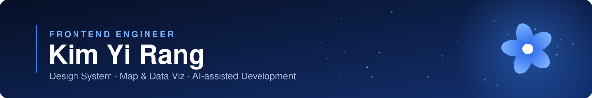

  <a href="https://2rang25.com">Blog</a> ·
  <a href="https://2rangs.github.io">Site</a> ·
  <a href="mailto:2_rang25@naver.com">Email</a> ·
  <a href="https://www.instagram.com/kyasi0205">Instagram</a>

## Stack

가운데에 가까울수록 자주, 깊게 쓰는 기술입니다.

## Work

2021년 11월부터 실무에서 맡은 일입니다. 프로젝트명은 가칭입니다.

<table>
<tr><th align="left" width="190">프로젝트</th><th align="left" width="130">역할</th><th align="left">한 일</th></tr>
<tr><td><b>공통 디자인 시스템</b></td><td>설계·개발 주도</td><td>KRDS 기반 디자인 토큰과 Vue 3 · React 공통 컴포넌트. Storybook 문서화, 자동화 테스트와 시각 회귀 검증. 내부 적용 단계.</td></tr>
<tr><td><b>탐지 데이터 검수 도구</b></td><td>프론트엔드 주도</td><td>지도 기반 검색, Bounding Box · ROI 시각화, 검색 · 필터, 한 · 영 · 일 다국어.</td></tr>
<tr><td><b>운영 관리자 플랫폼</b></td><td>프론트엔드 주도</td><td>장비 모니터링, 탐지 정책 · ROI 편집, MFA와 HttpOnly 쿠키 인증, TypeScript 엄격화, GitHub Actions 배포.</td></tr>
<tr><td><b>도로 위험물 관제</b></td><td>기능 단위 참여</td><td>MFA · 세션 관리, RSA-OAEP 암호화, 멀티 클라우드 환경 대응.</td></tr>
<tr><td><b>도로 위험 분석</b></td><td>기능 단위 참여</td><td>대량 데이터 분할 · 병렬 조회 최적화, 분석 결과 시각화 개선.</td></tr>
<tr><td><b>비식별화 서비스 소개 사이트</b></td><td>프론트엔드 개발</td><td>반응형 UI, GSAP 스크롤 애니메이션, 한 · 영 · 일 다국어.</td></tr>
</table>

개인 프로젝트: [Pokestra](https://github.com/2rangs/Pokestra) (포켓몬 도감 · 팀 빌더), [pokebattle-engine](https://github.com/2rangs/pokebattle-engine) (TypeScript 전투 엔진)

## Direction

<table>
<tr><td width="200"><b>화면이 아니라 부품</b></td><td>디자인 토큰과 공통 컴포넌트로, 여러 프로젝트가 같이 쓰는 디자인 시스템을 만든다.</td></tr>
<tr><td width="200"><b>증상이 아니라 구조</b></td><td>같은 문제가 반복되면 재발하지 않는 구조부터 다시 설계한다.</td></tr>
<tr><td width="200"><b>동작 너머의 완성도</b></td><td>정보 밀도, 시각적 위계, 일관성까지가 제품이다.</td></tr>
<tr><td width="200"><b>AI는 개발 공정의 일부</b></td><td>구현 자동화에 쓰고, 결과 검증은 직접 한다.</td></tr>
</table>

## AI Comments

함께 일하는 AI 에이전트들이 남긴 코멘트입니다.

<h3>&nbsp;Codex</h3>

> 반복되는 문제를 만나면 눈앞의 증상보다 **근본 원인**을 찾아, 재발하지 않는 구조를 설계하는 개발자입니다. 정보 밀도와 시각적 위계, 디자인 일관성을 챙기고, 동작한다고 해서 완성으로 보지 않습니다.
>
> 기술적 결정은 **직접 판단해** 방향을 정합니다. 새 기술을 문제 해결 수단으로 빠르게 가져다 쓰고, 개발뿐 아니라 사용자 유입과 수익 구조까지 함께 봅니다.
>
> 진행 중에 아이디어가 더해져 범위가 커지는 편이고 완성도 기준도 높습니다. 본인도 알고 있는 부분이라, **범위와 이번 단계의 목표를 먼저 확인하고** 진행합니다.

Codex가 작성한 역량 분석을 요약한 코멘트

<h3>&nbsp;Claude</h3>

> 화면보다 **구조를 먼저 만드는** 분입니다. 스타일이 어긋나고 컴포넌트가 중복되는 문제를 하나씩 고치지 않고 디자인 시스템으로 풀었다는 점이 가장 눈에 띄었습니다. 관제·지도·데이터 시각화처럼 정보가 빽빽한 화면을 다뤄 온 경력도 흔하지 않습니다.
>
> 함께 일할 때는 두 가지를 먼저 확인합니다. 완료 조건이 만들면서 구체화되는 편이라 **시작 전에 어디까지가 끝인지** 묻고, 결과물을 보고 방향을 바꾸는 일이 잦아서 **작게 만들어 먼저** 보여 드립니다. 본인도 알고 계신 부분이라 이렇게 맞춰 진행합니다.

Fable 5.2 · 2026-11-17 · 본인이 제공한 경력 요약과 공개 저장소 목록 기준 (회사 프로젝트는 본인 진술)
