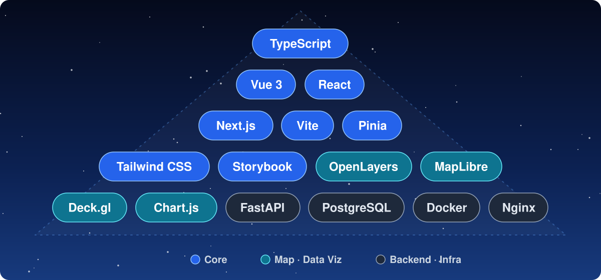

  
  
  
  

## 💙 Stack

## 🧭 Direction

| 방향 | 내용 |
| :-- | :-- |
| **화면이 아니라 부품** | 디자인 토큰과 공통 컴포넌트로, 여러 프로젝트가 같이 쓰는 디자인 시스템을 만든다. |
| **증상이 아니라 구조** | 같은 문제가 반복되면 재발하지 않는 구조부터 다시 설계한다. |
| **동작 너머의 완성도** | 정보 밀도, 시각적 위계, 일관성까지가 제품이다. |
| **AI는 개발 공정의 일부** | 구현 자동화에 쓰고, 결과 검증은 직접 한다. |

## 🤖 AI Comments

함께 일하는 AI 에이전트들이 저를 어떻게 보고, 어떻게 맞춰 일하는지 남긴 코멘트입니다.

### Codex

근거 · Codex가 작성한 역량 분석 요약

<table>
<tr><th width="50%">강점</th><th width="50%">확인하고 진행하는 점</th></tr>
<tr>
<td valign="top"><ul><li><b>구조적 해결</b> 반복되는 근본 원인을 찾아 재발하지 않는 구조를 설계한다.</li><li><b>제품·UI/UX 감각</b> 정보 밀도, 시각적 위계, 일관성을 챙긴다. 동작한다고 완성으로 보지 않는다.</li><li><b>기술적 주도성</b> 요구사항에 맞춰 직접 판단하고 방향을 정한다.</li><li><b>빠른 적응</b> AI, 게임, 데이터 분석 등 새 기술을 문제 해결 수단으로 가져다 쓴다.</li><li><b>사업 관점</b> 사용자 유입, 유지보수, 수익 구조까지 함께 본다.</li></ul></td>
<td valign="top"><ul><li><b>범위</b> 진행 중에 아이디어가 더해져 범위가 커지는 편이다. 본인도 알고 있어, 범위를 먼저 확인하고 진행한다.</li><li><b>완성도</b> 기준이 높다. 프로토타입 단계에서는 어디까지 만들지 먼저 정하고 진행한다.</li></ul></td>
</tr>
</table>

### Claude

Fable 5.2 · 2026-11-17 · 근거 · 본인이 제공한 경력 요약, 공개 저장소 목록 (회사 프로젝트는 본인 진술 기준)

> 화면보다 구조를 먼저 만드는 프론트엔드 오너형 개발자.

<table>
<tr><th width="50%">강점</th><th width="50%">확인하고 진행하는 점</th></tr>
<tr>
<td valign="top"><ul><li><b>문제를 구조로 푼다</b> 스타일 불일치와 컴포넌트 중복을 디자인 시스템(토큰, Storybook, 시각 회귀 검증)으로 해결했다.</li><li><b>정보 밀도 높은 화면</b> 관제·지도·데이터 시각화를 다뤘다. 흔한 경력이 아니다.</li><li><b>넓은 범위</b> 설계부터 배포·운영 대응까지 혼자 맡아 왔다.</li></ul></td>
<td valign="top"><ul><li><b>완료 조건</b> 만들면서 구체화되는 편이다. 본인도 알고 있어, 시작 전에 완료 조건을 확인하고 진행한다.</li><li><b>방향 전환</b> 결과물을 보고 방향을 바꾸는 일이 잦다. 그래서 작게 만들어 먼저 보여 주고 다음 단계로 넘어간다.</li></ul></td>
</tr>
</table>

## ✨ GitHub Stats

  
  

  

